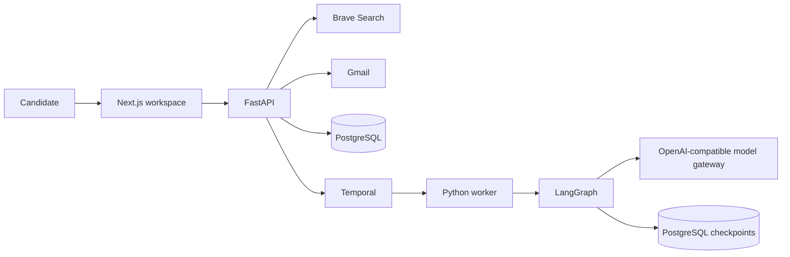

<div align="center">
  
  <h1>CareerReach AI</h1>
  <p><strong>Career clarity, with context.</strong><br />Research opportunities. Understand your fit. Reach out with evidence.</p>
</div>

<p align="center">
  <a href="https://github.com/ashucfx/careerreach-ai/actions/workflows/governance.yml"></a>
  <a href="https://github.com/ashucfx/careerreach-ai/actions/workflows/codeql.yml"></a>
</p>

<p align="center"><strong>Built with</strong></p>
<p align="center">
  <a href="https://nextjs.org"></a>
  <a href="https://react.dev"></a>
  <a href="https://www.typescriptlang.org"></a>
  <a href="https://www.python.org"></a>
  <a href="https://fastapi.tiangolo.com"></a>
  <a href="https://www.postgresql.org"></a>
  <a href="https://www.docker.com"></a>
  <a href="https://github.com/features/actions"></a>
</p>
<p align="center">
  <a href="https://www.langchain.com/langgraph"></a>
  <a href="https://temporal.io"></a>
</p>

---

CareerReach AI is an evidence-led career research and outreach workspace. It brings candidate context, job and company research, recruiter discovery, personalized outreach, campaign approval, and reply intelligence into one account-scoped product.

The product is designed around a simple rule: **show the evidence, let the candidate decide.** Research and generated claims stay tied to supplied sources, and email delivery requires an explicit approval step.

<p align="center"><a href="#product-workflows">Workflows</a> · <a href="#how-it-works">Architecture</a> · <a href="#technology">Technology</a> · <a href="#run-locally">Run locally</a> · <a href="#security-and-data">Security</a> · <a href="#roadmap">Roadmap</a></p>

## Product workflows

<table>
  <tr>
    <td width="50%"><h3>01 · Build candidate context</h3><p>Maintain a versioned profile. The API accepts PDF and DOCX resumes, extracts text, and validates each generated fact against an exact source quote.</p></td>
    <td width="50%"><h3>02 · Research opportunities</h3><p>Analyze saved job descriptions, compare candidate and role evidence, research companies, and discover relevant recruiters with retained source links.</p></td>
  </tr>
  <tr>
    <td width="50%"><h3>03 · Prepare thoughtful outreach</h3><p>Create evidence-grounded drafts, preview the message, and organize recipients in a campaign. Submission and approval happen before Gmail delivery.</p></td>
    <td width="50%"><h3>04 · Learn from replies</h3><p>Sync Gmail messages, classify intent with supporting quotes, and correct labels. Corrections are retained as feedback for evaluation.</p></td>
  </tr>
</table>

The browser workspace includes profile, job, company, recruiter-discovery, campaigns, inbox intelligence, agent directory, analytics, and integration views. Resume management and explicit job/recruiter matching are currently API workflows without dedicated frontend screens.

## How it works



LangGraph manages agent planning and state transitions. Temporal coordinates durable campaign and inbox-classification workflows. PostgreSQL stores account data and workflow checkpoints. The API routes reasoning, communication, and extraction tasks through a provider-neutral OpenAI-compatible interface.

## Technology

| Area | Implementation |
| --- | --- |
| Web application | Next.js 16 · React 19 · TypeScript |
| API | Python 3.12 · FastAPI · Pydantic |
| Agent graph | LangGraph · typed inputs and outputs · bounded parallel execution |
| Durable execution | Temporal Python SDK · worker activities |
| Database | PostgreSQL 17 · SQL migrations · row-level security |
| Vector extension | pgvector is installed; semantic embedding search is not yet wired into matching |
| Model gateway | OpenAI-compatible chat completions · structured output validation · retry and fallback |
| Connected providers | Brave Search · Gmail |
| Local environment | Docker Compose |
| Quality and security | Ruff · Pyright · Pytest · ESLint · TypeScript · dependency audit · secret scan · CodeQL |

The interface uses the supplied CareerReach identity: Executive Midnight `#0F1E36`, Signal Cobalt `#1D5EFF`, Verified Teal `#0D9488`, and Studio Alabaster `#F8FAFC`. The logo and product icons are kept in [`apps/web/public/brand`](apps/web/public/brand).

## Run locally

### Requirements

- Git
- Docker with the Compose plugin
- An OpenAI-compatible model API key for model-backed features
- Optional: Brave Search credentials for live research
- Optional: Google OAuth credentials and an email token encryption key for Gmail

### Start the stack

```powershell
Copy-Item .env.example .env
docker compose up --build
```

Set `POSTGRES_PASSWORD`, `CAREERREACH_RUNTIME_DATABASE_PASSWORD`, and `CAREERREACH_AUTH_SIGNING_KEY` in `.env`. Add `CAREERREACH_MODEL_API_KEY` and your provider’s model names to run model-backed features. Set `CAREERREACH_BRAVE_SEARCH_API_KEY` for research. To connect Gmail, configure the `CAREERREACH_GOOGLE_OAUTH_*` values and `CAREERREACH_EMAIL_TOKEN_ENCRYPTION_KEY`.

Open the web workspace at [http://localhost:3000](http://localhost:3000), the API documentation at [http://localhost:8000/docs](http://localhost:8000/docs), and the Temporal development UI at [http://localhost:8233](http://localhost:8233). Compose starts PostgreSQL, the Temporal development server, migrations, API, worker, and web application. The bundled Temporal server is for local development, not production.

### Quality checks

From the repository root:

```powershell
uv sync --locked --extra dev
uv run ruff format --check .
uv run ruff check .
uv run pyright
uv run pytest -q
```

From `apps/web`:

```powershell
npm ci
npm run typecheck
npm run lint
npm run build
```

Score inbox-classifier predictions against the synthetic golden dataset:

```powershell
python scripts/evaluate_inbox.py path\to\predictions.jsonl --min-accuracy 0.8 --min-grounding 0.95
```

GitHub Actions runs the backend and frontend quality jobs, database migrations, tests, dependency audits, repository hygiene, secret scanning, and CodeQL analysis on pushes and pull requests.

## Security and data

- User-owned records are accessed with account-scoped PostgreSQL policies.
- Gmail refresh tokens are encrypted before storage.
- Resume binaries are discarded after parsing; extracted text and evidence remain until deleted.
- Campaign delivery is approval-gated.
- Browser access tokens stay in memory and are cleared when the page reloads.
- Use synthetic candidate and email data in development.

The project does not yet provide account email verification or recovery, login rate limiting, automated retention policies, or production hosting. Temporal history and checkpoints may contain career context; production operators must define access, backup, retention, and deletion procedures.

## Roadmap

The broader product plan extends beyond this MVP:

- Add embeddings, vector retrieval, and reranking to matching; pgvector is present but unused by the current match paths. Redis is not in the current stack.
- Add dedicated contact enrichment and email verification, Outlook and calendar providers, and follow-up scheduling.
- Bring resume workflows and explicit job/recruiter matching into the frontend.
- Add CRM and opportunity tracking, user preferences, and career outcome analysis.
- Expand evaluation datasets and CI quality gates beyond inbox classification to research, matching, contacts, and outreach.
- Add OpenTelemetry/Langfuse traces, model cost reporting, container scanning, license checks, and production dashboards.
- Establish staging and production deployment, managed secrets, backups, migration controls, and rollback procedures.
- Complete end-to-end operational flows for contact verification, career recommendations, and quality-policy review agents.

## License

CareerReach AI is proprietary software. All rights are reserved by the copyright holder; no permission is granted to copy, modify, redistribute, sublicense, or create derivative works without prior written permission, except where applicable law requires otherwise. See [`LICENSE`](LICENSE) for the terms and permission contact.

This license does not technically prevent cloning or forking while the GitHub repository is public. GitHub's Terms of Service allow users to view and fork public repositories. To restrict new access and forks, change the repository visibility to **Private** in GitHub settings; that will not remove copies or forks already made. See [GitHub's licensing guidance](https://docs.github.com/en/repositories/managing-your-repositorys-settings-and-features/customizing-your-repository/licensing-a-repository).
