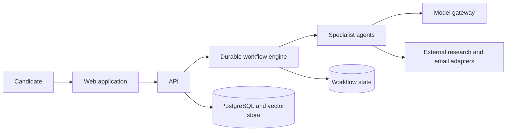

# CareerReach AI

CareerReach AI is an agent-native career research and outreach platform. Its goal is to help candidates research opportunities, understand fit, and prepare evidence-based outreach with clear human approval points.

> **Current status:** The API, typed agent runtime, dependency-aware LangGraph execution, Temporal workflow service, and PostgreSQL checkpoint storage are implemented. Authentication, external research and email integrations, and the web application remain planned.

## Product direction

The intended platform combines candidate profile intelligence, job and company research, recruiter discovery, evidence-based matching, personalized outreach, and campaign and inbox workflows. Agent plans and actions should remain inspectable, traceable to sources, and subject to user approval where they affect external services.

## Target architecture

The target design uses a Next.js and TypeScript web application, a Python FastAPI service, LangGraph for agent-level state transitions, and Temporal for durable business workflows. PostgreSQL with pgvector stores workflow checkpoints and is prepared for semantic search. A provider-neutral model gateway routes model tasks. A local development stack is provided with Docker Compose; its Temporal server runs in development mode and is not a production deployment.



## Repository status

The current implementation contains a FastAPI service, typed workflow and agent schemas, a model gateway for OpenAI compatible chat completion APIs, a bounded concurrent orchestrator, twelve specialist agent specifications, a Temporal worker, PostgreSQL-backed LangGraph checkpoints, a hygiene check, and GitHub Actions checks. Agent runs use only user supplied context and evidence; there are no research, contact, or email provider adapters yet. Durable workflow results can be queried while retained by Temporal; checkpoints are keyed by workflow run ID.

## Local development

Requirements for the containerized stack: Docker Compose, a PostgreSQL password, a signing key, and an OpenAI-compatible model API key. The API can also run directly with Python 3.12 or later and [uv](https://docs.astral.sh/uv/).

Copy the environment template, set `POSTGRES_PASSWORD`, `CAREERREACH_AUTH_SIGNING_KEY`, and `CAREERREACH_MODEL_API_KEY`, then start the API, PostgreSQL, and Temporal worker:

```powershell
uv sync --locked --extra dev
Copy-Item .env.example .env
docker compose up --build
```

The `.env` file contains variable names only. Generate 64-character hexadecimal values for `POSTGRES_PASSWORD` and `CAREERREACH_AUTH_SIGNING_KEY` with `python -c "import secrets; print(secrets.token_hex(32))"`; this keeps the PostgreSQL password safe to interpolate in the local Compose connection string. Set `CAREERREACH_MODEL_API_KEY` and the model URL and model names for your provider. Compose waits for PostgreSQL and Temporal, runs the versioned SQL migrations, then starts the API and worker. For direct local development without Compose, set `CAREERREACH_DATABASE_URL`, `CAREERREACH_AUTH_SIGNING_KEY`, and `CAREERREACH_TEMPORAL_ADDRESS`, start PostgreSQL and Temporal separately, run `uv run python -m careerreach.migrations`, then start the API with `uv run uvicorn careerreach.main:app --app-dir apps/api --reload` and the worker with `uv run --directory apps/api python -m careerreach.worker`. The service exposes OpenAPI documentation at `/docs` and its schema at `/openapi.json`.

Authentication is available through `POST /api/v1/auth/register` and `POST /api/v1/auth/token`. Send the returned bearer token to protected workflow routes. `GET /api/v1/auth/me` returns the account identity; `POST /api/v1/auth/logout` revokes that session. The auth integration test exercises registration, duplicate account rejection, login, identity retrieval, and session revocation against PostgreSQL.

`POST /api/v1/workflows/plan` creates a structured plan, `POST /api/v1/workflows/execute` runs it synchronously, and `POST /api/v1/workflow-runs` starts a durable Temporal run. Query durable runs with `GET /api/v1/workflow-runs/{run_id}`. These workflow routes require authentication. Temporal retries activity failures; LangGraph checkpoints progress in PostgreSQL. The current durable path requires a configured model API key and a running worker.

## Local checks

Git is also required for the repository hygiene check.

Run the repository hygiene check from the repository root:

```powershell
python scripts/repository_hygiene.py
```

The check allows only the root `README.md` as Markdown, rejects tracked environment and credential files, flags selected secret patterns, and rejects generated dependency and build directories. GitHub Actions runs the check on pushes and pull requests; a GitHub secret scan also runs in CI.

Run backend quality checks with `uv run ruff format --check .`, `uv run ruff check .`, `uv run pyright`, and `uv run pytest -q`.

## Security and data handling

Do not commit credentials or environment-specific files. User identity and revocable sessions are implemented, and workflow routes require a valid account token. Candidate data stores, tenant-level row policies, email verification and account recovery, login rate limiting, retention, and deletion behavior are not implemented yet. Durable checkpoints and Temporal history can contain user-provided career context, so use synthetic data in development and apply appropriate access and retention controls before production. The system does not send messages or call external research services. The planned platform will require tenant isolation, provenance, retention controls, and approval before external actions.

## License

No license has been selected or added. Until one is chosen, reuse and redistribution permissions are not granted by this repository.
