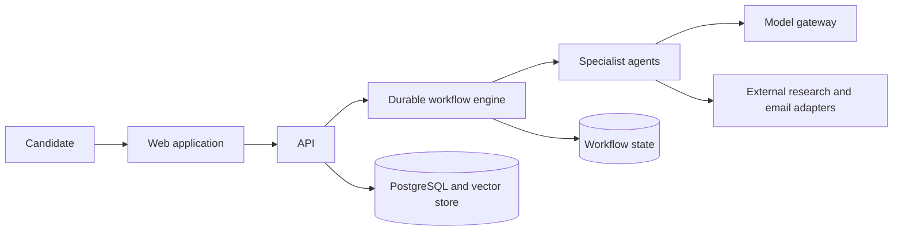

# CareerReach AI

CareerReach AI is planned as an agent-native career research and outreach platform. Its goal is to help candidates research opportunities, understand fit, and prepare evidence-based outreach with clear human approval points.

> **Current status:** This repository is at its initial governance stage. Product workflows, integrations, model routing, database schemas, and deployment are not implemented yet.

## Product direction

The intended platform combines candidate profile intelligence, job and company research, recruiter discovery, evidence-based matching, personalized outreach, and campaign and inbox workflows. Agent plans and actions should remain inspectable, traceable to sources, and subject to user approval where they affect external services.

## Target architecture

The target design uses a Next.js and TypeScript web application, a Python FastAPI service, LangGraph for agent-level state transitions, and Temporal for durable business workflows. PostgreSQL with pgvector is the target transactional and semantic store, with Redis for caching. A provider-neutral model gateway will route model tasks. These are architectural targets, not implemented or verified capabilities.



## Repository status

The current implementation contains repository governance checks and GitHub issue forms. It does not yet contain the web application, API, agent runtime, database migrations, integrations, or deployment configuration.

## Local checks

Requirements: Python 3.10 or later and Git.

Run the repository hygiene check from the repository root:

```powershell
python scripts/repository_hygiene.py
```

The check allows only the root `README.md` as Markdown, rejects tracked environment and credential files, flags selected secret patterns, and rejects generated dependency and build directories. GitHub Actions runs this check on pull requests and pushes to `main` or `master`; a GitHub secret scan also runs in CI.

There are no application startup or test commands yet because no application code has been added.

## Security and data handling

Do not commit credentials or environment-specific files. No production data handling, account isolation, retention, or deletion behavior has been implemented yet. The planned platform will require explicit tenant isolation, provenance, retention controls, and approval before sending external communications.

## License

No license has been selected or added. Until one is chosen, reuse and redistribution permissions are not granted by this repository.
