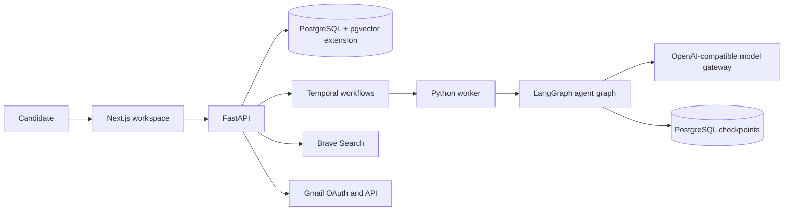

<p align="center">
  
</p>

<h1 align="center">CareerReach AI</h1>

<p align="center"><strong>Career clarity, with context.</strong><br />An evidence-led workspace for researching opportunities, preparing outreach, and understanding replies.</p>

<p align="center">
  <a href="https://github.com/ashucfx/careerreach-ai/actions/workflows/governance.yml"></a>
  <a href="https://github.com/ashucfx/careerreach-ai/actions/workflows/codeql.yml"></a>
</p>

> **Delivery status:** All ten implementation phases are merged to the repository’s default branch. The merged Phase 10 pull request passed backend quality, frontend quality, dependency audit, repository hygiene, secret scan, and CodeQL checks. The wider architecture below still contains capabilities intentionally outside this MVP.

## 🚀 What CareerReach does

CareerReach AI helps a candidate organize career context, research roles and companies, find recruiter contacts, prepare sourced outreach, and review replies. Model-generated findings must use supplied source material; email delivery remains behind an explicit campaign approval step.

The application currently includes:

- 🔐 Account registration, login, short-lived bearer sessions, and session revocation.
- 👤 Versioned candidate profiles and backend resume ingestion for PDF and DOCX files, with source-quoted extraction.
- 💼 Job description analysis, candidate-to-job matching endpoints, company research, and source-backed recruiter discovery and matching.
- ✉️ Evidence-grounded outreach drafts and campaigns with submit, approve, pause, resume, retry, and cancel controls.
- 📥 Gmail synchronization, inbox classification, supporting quotes, and human label corrections.
- 🤖 A typed agent directory, LangGraph execution graph, PostgreSQL checkpoints, and Temporal workflows for durable tasks.
- 📊 Workspace counts for jobs, contacts, campaigns, and inbox classification feedback.
- 🛡️ PostgreSQL tenant policies, dependency scanning, secret scanning, CodeQL, health checks, and frontend/backend CI.

The browser workspace exposes the profile, job, company, recruiter-discovery, outreach-campaign, inbox, agent, analytics, and integration workflows. Resume management and the explicit match operations are available in the API but do not yet have dedicated frontend screens.

## 🧠 Architecture



LangGraph handles agent planning and state transitions. Temporal handles durable campaign delivery and inbox-classification jobs. The API and worker share PostgreSQL; model calls use a replaceable OpenAI-compatible HTTP interface. Research and email integrations are provider-specific adapters.

## 🛠️ Technology stack

| Layer | Technologies |
| --- | --- |
| Web | Next.js 16, React 19, TypeScript, ESLint |
| API | Python 3.12, FastAPI, Pydantic, Ruff, Pyright |
| Agent execution | LangGraph, typed agent schemas, bounded parallel steps |
| Durable workflows | Temporal Python SDK and worker activities |
| Data | PostgreSQL 17, SQL migrations, row-level security, pgvector extension |
| Model access | Task-routed OpenAI-compatible chat completions, structured output validation, retries and fallback |
| Integrations | Brave Search and Gmail |
| Delivery | Docker Compose for local development; GitHub Actions CI, dependency audit, and CodeQL |

Brand colors follow the supplied system: Executive Midnight `#0F1E36`, Signal Cobalt `#1D5EFF`, Verified Teal `#0D9488`, and Studio Alabaster `#F8FAFC`. The product logo and interface icons are in [`apps/web/public/brand`](apps/web/public/brand).

## 💻 Run locally

### Prerequisites

- Git and Docker with the Compose plugin.
- An OpenAI-compatible model API key for model-backed workflows.
- Optional Brave Search credentials for live web research.
- Optional Google OAuth credentials and an email-token encryption key for Gmail sync and approved delivery.

Copy the environment template, set the required local values, and start the stack:

```powershell
Copy-Item .env.example .env
docker compose up --build
```

At minimum, set `POSTGRES_PASSWORD`, `CAREERREACH_RUNTIME_DATABASE_PASSWORD`, and `CAREERREACH_AUTH_SIGNING_KEY` in `.env`. Set `CAREERREACH_MODEL_API_KEY` and your provider’s model names to use model-backed features. Configure `CAREERREACH_BRAVE_SEARCH_API_KEY` for research and the `CAREERREACH_GOOGLE_OAUTH_*` variables plus `CAREERREACH_EMAIL_TOKEN_ENCRYPTION_KEY` for Gmail. Keep `.env` private; only `.env.example` belongs in Git.

Compose starts PostgreSQL, the Temporal development server, database migrations, API, worker, and web app. Open the workspace at `http://localhost:3000` and API documentation at `http://localhost:8000/docs`. The included Temporal server uses development mode and is for local use, not production.

## 🧪 Checks

Run backend checks from the repository root:

```powershell
uv sync --locked --extra dev
uv run ruff format --check .
uv run ruff check .
uv run pyright
uv run pytest -q
```

Run frontend checks from `apps/web`:

```powershell
npm ci
npm run typecheck
npm run lint
npm run build
```

The inbox evaluation utility scores supplied JSONL predictions against a synthetic, non-user dataset:

```powershell
python scripts/evaluate_inbox.py path\to\predictions.jsonl --min-accuracy 0.8 --min-grounding 0.95
```

GitHub Actions runs backend migration and test checks, frontend checks, dependency audits, repository hygiene, secret scanning, and CodeQL. The repository hygiene rule permits only this root `README.md` as a Markdown file.

## 🔐 Data and security

Account-owned profile, resume, research, campaign, and inbox records use tenant-scoped database access. Resume binaries are parsed and discarded; extracted text and evidence remain in the account until deleted. Gmail refresh tokens are encrypted in PostgreSQL, and campaigns require approval before execution. The browser holds its access token in memory, so refreshing the page ends that browser session.

Use synthetic candidate and email data in development. Before production, configure HTTPS and managed secrets, define retention and deletion procedures for workflow history, and deploy a production Temporal service. The repository does not include a production deployment pipeline or a configured hosting environment.

## 🧭 Remaining roadmap

These are broader architecture goals, not unfinished Phase 10 checks:

- Semantic retrieval with embeddings and reranking; pgvector is installed but the current matching flows do not yet use vector search. Redis is not part of the running stack.
- Dedicated contact enrichment and email verification, plus Outlook and calendar integrations. Current external adapters are Brave Search and Gmail.
- Frontend workflows for resume upload/extraction and explicit candidate-job and recruiter matching.
- Full CRM/opportunity tracking, follow-up scheduling, career outcome analysis, and persistent user preferences.
- Dedicated evaluation datasets and CI quality gates for matching, contact relevance, research factuality, and outreach quality. The current evaluation harness covers inbox classification output only.
- OpenTelemetry/Langfuse traces, cost reporting, and production operational dashboards.
- Production staging/deployment, container vulnerability scanning, license policy checks, backups, and rollback procedures.
- Account email verification and recovery, login rate limiting, and configurable data-retention policies.

Twelve specialist roles are described in the agent directory. Several have dedicated product flows today; contact verification, career recommendations, and quality-policy review still need end-to-end implementations and evaluation before they should be presented as operational features.

## 📄 License

No license has been selected. Until one is added, this repository does not grant reuse or redistribution rights.
