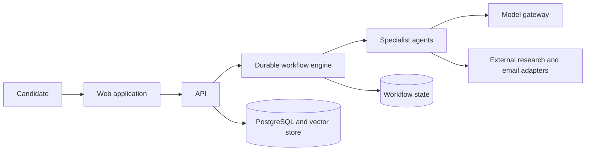

# CareerReach AI

CareerReach AI is planned as an agent-native career research and outreach platform. Its goal is to help candidates research opportunities, understand fit, and prepare evidence-based outreach with clear human approval points.

> **Current status:** The first API and agent runtime slice is implemented. Durable storage, authentication, external research and email integrations, and the web application remain planned.

## Product direction

The intended platform combines candidate profile intelligence, job and company research, recruiter discovery, evidence-based matching, personalized outreach, and campaign and inbox workflows. Agent plans and actions should remain inspectable, traceable to sources, and subject to user approval where they affect external services.

## Target architecture

The target design uses a Next.js and TypeScript web application, a Python FastAPI service, LangGraph for agent-level state transitions, and Temporal for durable business workflows. PostgreSQL with pgvector is the target transactional and semantic store, with Redis for caching. A provider-neutral model gateway will route model tasks. These are architectural targets, not implemented or verified capabilities.



## Repository status

The current implementation contains a FastAPI service, typed workflow and agent schemas, a model gateway for OpenAI compatible chat completion APIs, a bounded concurrent orchestrator, twelve specialist agent specifications, a hygiene check, and GitHub Actions checks. Agent runs use only user supplied context and evidence; there are no research, contact, or email provider adapters yet. Results are not persisted between restarts.

## Local development

Requirements: Python 3.11 or later and [uv](https://docs.astral.sh/uv/).

Install the locked dependencies and start the API:

```powershell
uv sync --locked --extra dev
Copy-Item .env.example .env
uv run uvicorn careerreach.main:app --app-dir apps/api --reload
```

Set `CAREERREACH_MODEL_API_KEY` in `.env` to enable model-backed planning and execution. Without it, the API still serves health and agent catalog routes, while model workflows return a configuration error. The service exposes OpenAPI documentation at `/docs` and its schema at `/openapi.json`.

## Local checks

Git is also required for the repository hygiene check.

Run the repository hygiene check from the repository root:

```powershell
python scripts/repository_hygiene.py
```

The check allows only the root `README.md` as Markdown, rejects tracked environment and credential files, flags selected secret patterns, and rejects generated dependency and build directories. GitHub Actions runs the check on pushes and pull requests; a GitHub secret scan also runs in CI.

Run backend quality checks with `uv run ruff format --check .`, `uv run ruff check .`, `uv run mypy apps/api/careerreach`, and `uv run pytest -q`.

## Security and data handling

Do not commit credentials or environment-specific files. The API does not yet have user authentication, tenant isolation, durable data storage, retention, or deletion behavior. It does not send messages or call external research services. The planned platform will require tenant isolation, provenance, retention controls, and approval before external actions.

## License

No license has been selected or added. Until one is chosen, reuse and redistribution permissions are not granted by this repository.
